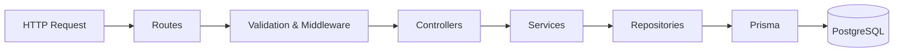

 

---

## 👨‍💻 About Me

I'm a **Computer Engineering student in India** who learns by building. My focus is **full-stack web development and SaaS engineering**: database design, backend architecture, authentication, responsive interfaces, testing, and deployment.

My long-term goal is to become an independent full-stack engineer, land a strong software engineering role, and eventually build a serious SaaS product for the US market. Along the way I contribute to open source to learn how professional teams review, test, and ship code.

| | |
|---|---|
| 🎓 **Education** | B.Tech, Computer Engineering |
| 🔭 **Building** | CollabSpace, a multi-tenant SaaS delivery platform |
| 🌱 **Learning** | PostgreSQL internals, testing strategy, API security, system design |
| 🧩 **Practicing** | Data structures & algorithms |
| 🤝 **Contributing** | Open source through SWoC, aiming for GSoC 2027 |
| 🚀 **Aiming for** | Software engineering internship/placement, then SaaS founder |

---

## 🧰 Tech Stack

| Area | Technologies |
|---|---|
| **Languages** | TypeScript, JavaScript, C++, Python |
| **Frontend** | React, Vite, React Router, Redux Toolkit, TanStack Query, Tailwind CSS |
| **Backend** | Node.js, Express, REST APIs, JWT authentication, bcrypt |
| **Databases** | PostgreSQL, Prisma ORM, MongoDB Atlas, Redis |
| **Testing** | Vitest |
| **DevOps & Tooling** | Git, GitHub, Docker, Docker Compose, Vercel, Render |
| **AI Integration** | Gemini API, Anthropic SDK, Ollama / Gemma |
| **CS Fundamentals** | DSA, OOP, Operating Systems, DBMS, Computer Architecture |

---

## 🚀 Featured Projects

### 🧩 CollabSpace
**AI Delivery Control Plane for engineering teams** · *In active development*

Most project tools show what was planned. CollabSpace is designed to surface the gap between **what was planned, what is actually happening, what risks have appeared, and what needs to change** to deliver on time.

**Engineering highlights**

- 🏗️ **Layered backend architecture** that keeps HTTP handling, business rules, and data access separate
- 🔐 **JWT authentication** with refresh-token rotation and bcrypt password hashing
- 🏢 **Multi-tenant design**: roles belong to *workspace memberships*, not to users globally (Owner, Admin, Member, Viewer)
- 🛡️ **Server-side authorization**: the backend derives permissions from database membership, never from the client
- 🧪 **Security-focused tests** covering tenant isolation and privilege boundaries
- ⚛️ **Clear frontend state split**: Redux Toolkit for UI state, TanStack Query for server state

**Stack:** `React` `TypeScript` `Vite` `Redux Toolkit` `TanStack Query` `Node.js` `Express 5` `PostgreSQL` `Prisma` `Docker` `Vitest`

---

### 🏠 NCR PropertyDesk
**Real estate platform for property owners and seekers** · [🌐 Live Site](https://www.ncrpropertydesk.com/)

A deployed full-stack application that connects property owners with people searching for homes.

- 📋 Owner listings and property management
- 🔎 Property search with map-based discovery
- ✨ AI-generated listing descriptions
- 💰 Price estimation and recommendations
- 🖼️ Image handling with Cloudinary, caching with Redis
- ☁️ Frontend on Vercel, backend on Render

**Stack:** `React` `Node.js` `Express` `MongoDB Atlas` `Redis` `Cloudinary` `Gemini` `Anthropic SDK` `Docker Compose`

---

### 📚 PrepFlow
**Turns scattered study material into a realistic study plan** · *Built with AI coding tools*

PrepFlow doesn't just summarize notes. It answers *"what should I study next, and how should I use the time I have?"*

- 📄 Extracts topics and subtopics from study material
- 🔗 Links each topic to supporting evidence in the source
- 📊 Prioritizes topics and builds feasible daily plans with deterministic rules
- 🧠 **Design principle: AI interprets, deterministic software decides.** The model never decides whether a schedule fits the student's available time.

📝 Submitted to the **DEV Hacktoberfest 2026 launch-weekend challenge** with a published write-up on DEV.

**Stack:** `React` `Vite` `Tailwind CSS` `Express` `TypeScript` `PostgreSQL` `Prisma` `Ollama / Gemma` `Vitest`

---

### 🚶 PocketWalk
**A one-tap outdoor walk planner** · *Built with AI coding tools* · [🌐 Live Demo](https://pocketwalk.onrender.com)

Pick a walk based on current weather, then put your phone away.

- 🌤️ Live weather context from Open-Meteo
- 🔁 Deterministic fallback planner so the app keeps working when AI planning is unavailable
- 🚦 Request limits and concurrency controls
- 🧪 Automated backend and frontend test suites, with a quality-checkpoint workflow
- ☁️ Frontend served from the backend on one origin, deployed on Render

**Stack:** `React` `Node.js` `Express` `TypeScript` `Render`

---

## 🤝 Open Source

| Repository | Contribution | Skills Demonstrated | Status |
|---|---|---|---|
| [free-llm-api-hub](https://github.com/pacocartones/free-llm-api-hub) | [PR #198](https://github.com/pacocartones/free-llm-api-hub/pull/198): Verified a provider's signup requirements, updated the source-of-truth data file, and regenerated derived artifacts | Data verification, repository workflow, validation, review handling | ✅ Merged |
| [ChatCops](https://github.com/codercops/chatcops) | [PR #104](https://github.com/codercops/chatcops/pull/104): Enforced server-compatible input length limits in the widget (500-char pre-chat fields, 10,000-char messages) with tests and a patch changeset | TypeScript/DOM, testing, release metadata, code review | ✅ Merged |

**Programs:** Social Winter of Code, Season 7 (2026–27) · Hacktoberfest 2026

### 🎯 GSoC 2027 Roadmap

| Phase | Goal |
|---|---|
| **1. Explore** | Study past GSoC organizations and shortlist those matching my stack (TypeScript, React, Node.js). Currently exploring Joplin, Zulip, webpack, Rocket.Chat, and Learning Equality. These are candidates, not confirmed 2027 participants. |
| **2. Contribute** | Make consistent, focused contributions through SWoC and beyond, moving from small fixes to larger multi-file changes in 2–3 target projects. |
| **3. Own it** | Reproduce bugs, write the failing test first, implement the fix, and explain the reasoning in every PR. |
| **4. Engage** | Join project chats, review other contributors' work, and respond to maintainer feedback quickly. |
| **5. Propose** | Once organizations are announced, confirm eligibility, draft a scoped proposal with milestones, and get mentor feedback before the deadline. |

---

## 🧭 Engineering Principles

- **The server is the source of truth for authorization.** The frontend can display permissions but never grants them.
- **Roles belong to memberships, not users.** One person can be an Owner in one workspace and a Viewer in another.
- **Use the right tool for the job.** AI for interpretation, deterministic code for decisions that must be correct.
- **Verify, don't assume.** Run the tests, check the diff, and inspect the real contract before changing code.
- **Keep changes focused and explainable.** A small, tested change that I can fully defend beats a large one I can't.

---

## 📈 GitHub Stats

---

## 🔭 Currently Focused On

- ✅ Building and explaining every layer of CollabSpace independently
- ✅ PostgreSQL beyond CRUD: transactions, indexes, query design
- ✅ Writing my own tests, including failure and boundary cases
- ✅ Authentication, authorization, and multi-tenant security
- ✅ Consistent DSA practice
- ✅ Open-source contributions toward GSoC 2027

---

*"Make it work, make it right, make it tested."*

